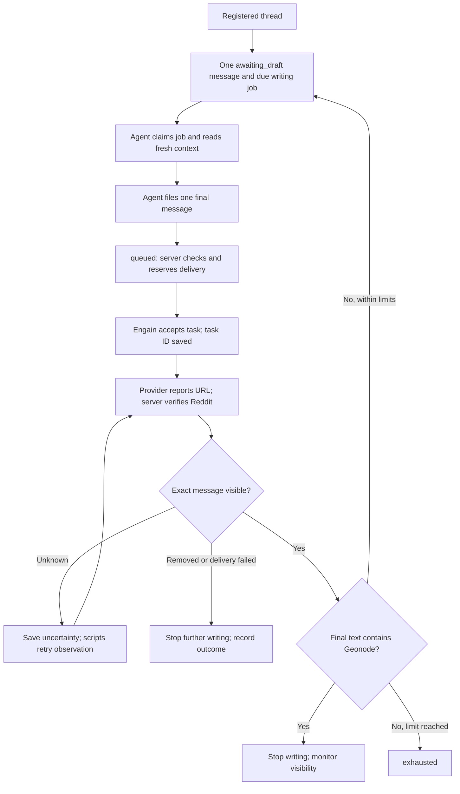

# Message system: architecture, delivery and tracking

Documentation revision: 2026-10-11. Implementation reference: agent protocol 5, migrations through `043-message-decision-context.sql`.

The agent decides what useful message to write and which permitted parent it answers. Server code owns publishing, provider status, Reddit verification, scheduling and reporting. Every invocation can start with no conversational memory: durable jobs and saved context carry the work forward.

This system is for disclosed Geonode participation that follows community rules. A follow-up must have a useful purpose of its own. Do not use multiple delivery accounts to portray independent customers, manufacture agreement or conceal promotion. Confirmed removals stop the flow; they are not instructions to try another branch.

## Read this first: implemented versus specified

This document describes both the current implementation and the requested tracking design. Sections marked **target design** require implementation. Writing these docs does not migrate the database, change a live schedule, deploy code or start a worker.

| Capability | Current implementation | Target / qualification |
| --- | --- | --- |
| One message decision at a time | Implemented | No advance conversation plan |
| Automatic delivery and observation | Implemented in server cron | Requires working provider credentials and readable Reddit evidence |
| Parent linkage, placement, text and brand flag | Implemented | Parent and brand flag are derived and validated by the server |
| Durable writer leases and checkpoints | Implemented | A daily agent launcher is external to this repository |
| Brand mention verified public | Recorded as `brand_visible_at`; writing stops | Requested primary success should be immediate |
| `success_at`, `succeeded`, success charts | Currently require a fresh seven-day check | Must change or be renamed before displaying immediate publication success |
| Full history of revisions, attempts and observations | Partial: current rows and selected logs | Append-only message events are **not implemented** |
| Failed steps included in a complete flow report | Message rows retain failed work | Existing shape aggregate includes only previously verified messages |
| Balanced content suggestions | Implemented, 20% target per action per stage | No learned policy or automatic performance-based reweighting |
| Mixing new threads and follow-ups | Jobs ordered by due time and ID | Reserved queue shares in the queue simulation are **a proposal** |
| Humanizer | Optional provenance fields implemented | No humanizer service is configured in the server |
| Disclosure evidence before filing | Worker instruction in this documentation | No dedicated message-workflow disclosure field or server gate yet |

Use [the agent runbook](agent-runbook.md) for requests that work today. Use [the tracking specification](message-tracking.md) for the changes needed to meet the requested reporting behavior. The current bootstrap and database remain authoritative for wire formats and state meanings.

## Responsibilities

| Component | Owns | Does not need |
| --- | --- | --- |
| Daily writing agent | Read context; assess relevance and attribution; select an offered parent and content action; prepare one final message; save a short rationale | Engain key, account allocation, polling loops, success calculations |
| Discovery worker, when explicitly assigned | Find permitted relevant threads, register evidence and queue a first message | A prewritten sequence of replies |
| Application API | Authentication, job ownership, fresh context, input validation, filing | Agent conversational memory |
| Database functions | Atomic state transitions, parent linkage, limits, deduplication and reservations | Model judgment |
| Server cron | Reconciliation, submission, polling, saved URLs, visibility checks, next eligible job and monitoring | An AI session or manual send approval |
| Engain | Delivery task and provider observations | Authority to declare our verified Reddit outcome |
| Dashboard / reports | Show queue, evidence, outcomes and limitations | A separate operator API key entered by the dashboard user |

The writer may use an authorized style-editing tool. That tool improves clarity while preserving meaning and attribution; it must not simulate independent experiences or hide affiliation.

## The unit of work

A **thread** is the Reddit discussion. An **experiment**, also called a **flow** in these docs, groups our messages and observations within that discussion. A **message** is one proposed or published contribution. A **job** is the leased task of preparing that one message.

There are two distinct parent relationships:

- `previous_message_id`: the latest publication that caused this new queue turn. It is the preceding chronological step.
- `parent_message_id`: the comment the new message actually answers. For a sibling, this differs from the previous message.

`target_url` is where to post. `reddit_url` is the new comment's own permalink, learned after submission. Never fill the latter with the former.

`step` counts messages chronologically, including siblings. `depth` counts levels below the thread. Neither is a queue position.

| Step | Placement | Previous step | Actual parent | Depth |
| --- | --- | --- | --- | --- |
| 1 | `opening` | None | Thread | 1 |
| 2 | `reply` | 1 | Message 1 | 2 |
| 3 | `chain` | 2 | Message 2 | 3 |
| 4 | `sibling` | 3 | Message 2 | 3 |

This is an illustration of relationships, not a sequence to generate in advance. Each later row can exist only after the previous publication has been verified and the flow remains eligible.

## One message lifecycle

For the requested reporting definition, reaching the verified-brand branch is **publication success immediately**. Current protocol 5 labels this `monitoring` and waits seven days before setting `success_at`; see the status table above. The agent must never write success timestamps itself.

### 1. Queue the thread

Queueing creates one opening message and its writing job. New flows default to six messages and four levels; both limits accept 1–10 at creation. Read the actual job limits because older flows can differ.

The opening strategy is fixed for that flow. Current strategies are `direct`, `question`, `context`, `help` and `method`; only `direct` requires the literal Geonode mention in the opening. An assignment never excuses missing attribution or irrelevant content. If a fixed opening condition conflicts with adequate disclosure or a useful answer, the writer skips or blocks with a reason rather than hiding the relationship.

### 2. Prepare the next message

The writer claims a due job. The response includes the current message, previous messages, fresh Reddit observations, allowed parent options, limits, action suggestion and a lease token.

There are three separate decisions:

1. **Placement:** opening, first reply, chain or sibling, selected from available options.
2. **Content action:** relevant recommendation, useful question, supported context, practical help or method.
3. **Brand relevance:** whether the final text appropriately names Geonode, including required attribution.

Choose for the actual discussion. A returned option means the API can represent the relationship; it does not mean another comment is useful. Stop when there is nothing useful to add.

Filing saves exactly one final body and completes the writing job atomically. It queues delivery. It is not a draft-only save awaiting a further approval. The writer uses checkpoints for unfinished work.

### 3. Check and submit automatically

[`api/cron/tick.js`](../api/cron/tick.js) runs every 15 minutes as configured in [`vercel.json`](../vercel.json). A database clock lease prevents overlapping ticks. The message tick has a time budget and bounded batches; a scheduled tick is not a promise that every due message is handled immediately.

[`api/_messages.js`](../api/_messages.js) runs these phases:

1. Reconcile ambiguous submissions against provider tasks.
2. Poll existing tasks and verify saved publication URLs.
3. Mark messages held when their writing jobs have stopped or failed.
4. Dispatch due queued messages when the send schedule permits.

Before submission, the server rereads the exact target, checks the preceding publication where necessary, checks Engain rules and reserves the exact body/parent/target. A concurrent edit invalidates that reservation attempt.

Current global pacing is at least 45 minutes between sends, at least 24 hours per subreddit, and at most 20 per UTC day. Limits are checked at reservation time as well as used for scheduling. A job becoming due does not bypass these limits.

### 4. Save provider progress and verify publication

Engain acceptance gives us a task ID. It does not establish public visibility. The server saves the task ID, polls for the comment URL, and verifies:

- The URL identifies a comment in the expected thread.
- Its parent matches the submitted target.
- Its body matches the submitted body after the implementation's whitespace normalization.
- It has a valid author; when a specific private-account username is known, that username matches.

The implementation stores fresh evidence and the first verification time. A provider `published` status without readable matching Reddit evidence remains unconfirmed. HTTP 403, a timeout or a body mismatch is not proof of removal.

Current observation scheduling sets the next visibility check approximately 30 minutes later; cron cadence, batch limits and service availability can delay it. Seven-day survival means observed visibility at checks, including a fresh check at or after the deadline. It does not prove continuous visibility between checks.

### 5. Return eligible work to the writing queue

A verified unbranded message can create exactly one next message and job. Its stored permalink becomes the source of the next decision.

- After an opening, the only placement is `reply` to that opening.
- After later messages, `chain` answers the latest message; `sibling` answers that latest message's parent.
- Both source and selected parent must remain valid. A sibling cannot be used to bypass a removed source.
- A verified brand mention stops further writing.
- Every message, including a sibling, consumes the message budget. At the depth ceiling, chain is excluded. At the message ceiling, writing ends even without a brand mention.

The current code can produce a follow-up writing job mechanically after an unbranded publication. The writer still decides whether a useful, permitted follow-up exists. A queue entry is not an obligation to post.

## Queue order and daily scheduling

There are separate queues for **writing**, **delivery**, and **observation**. Monitoring jobs do not occupy writing turns. Engain-pending messages do not become new writing jobs until the server verifies publication.

Current writer claims select due jobs by `due_at`, then job ID. Dispatch separately orders eligible queued messages by `next_check_at` and creation time. New threads are not currently ranked by popularity/recency in this claim scheduler. The dashboard's display order is not the scheduler's execution order.

Do not assign a returning comment a permanent position such as 10 or 20. Its place depends on eligibility and other due work. The standalone queue simulation demonstrates a possible allocation between new threads and follow-ups; it does not implement that allocation in production.

A future fairness scheduler can reserve capacity for both new work and useful follow-ups, borrowing an unused share when the other queue is empty. Persist its policy version and scheduling reason. Keep it separate from content decisions and moderation outcomes.

The 15-minute server cron does not wake an AI writer. The agent runner must separately invoke the [daily startup prompt](agent-runbook.md#reusable-startup-prompt), with its authorized credentials and tools. A daily cadence means new writing work may wait until the next daily invocation, while provider checks continue automatically. No extra conversation action named `wait` is necessary.

## Current states

### Message states

| State | Meaning | Writer action |
| --- | --- | --- |
| `awaiting_draft` | One writing decision exists | Claim the due job before working |
| `queued` | Final text saved, awaiting automatic delivery | Do not file another message for it |
| `held` | Needs attention; text/source/rule/job problem | Read the reason; do not bypass by creating another flow |
| `submitting` | Delivery reserved; provider request may be in flight | Leave reconciliation to scripts |
| `unknown` | Submission outcome uncertain | Do not resubmit independently |
| `submitted` | Provider task ID saved | Scripts poll and verify |
| `visible` | Has been verified public | Read `last_visibility` and timestamps for the latest observation |
| `removed` | Removal/deletion observed or reported | No further branch in this flow |
| `failed` | Delivery failed | Preserve reason; do not equate with moderator removal |
| `stopped` | Local work stopped | Do not resume through another job |

`status=visible` can coexist with `last_visibility=unknown` after an unreadable later check. It means previously verified, not necessarily readable now. Check timestamps and evidence rather than relying on the badge alone.

### Flow states in protocol 5

| State | Meaning today |
| --- | --- |
| `active` | Writing/delivery may continue within limits |
| `monitoring` | A Geonode mention was verified; writing ended; seven-day check pending |
| `succeeded` | Current seven-day criterion was confirmed |
| `removed` | Removal ended the flow before current success was confirmed |
| `exhausted` | Message/depth budget ended without the brand goal |
| `blocked` | Delivery problem stopped progress |
| `stopped` | Locally stopped |

Do not infer message state solely from flow state. For example, a held message can belong to an active flow. The target tracking design separates publication achievement, writing termination and monitoring outcome explicitly.

## Engain boundary

The writer authenticates to **our agent API** using `AGENT_API_KEY`. The server authenticates to **Engain** using `ENGAIN_API_KEY`. These keys have different owners and purposes. The writer needs no operator key, Supabase service key or cron secret.

For pooled delivery the adapter uses a configured or accessible project and creates a comment task for a thread or a reply task for an exact comment URL. The task ID is saved locally before polling. The existing private-account adapter uses a different provider contract. Both feed the same local message lifecycle; neither authorizes representing several accounts as independent participants.

The provider may allocate an account later. Protocol 5 does not expose verified disclosure/representation evidence in message jobs. If the worker cannot establish adequate public attribution from authorized configuration and current context, it must not file brand outreach. The missing transport/disclosure gate is a documented implementation gap, not something a prompt can prove automatically.

Rule-check `fail` holds text. `unavailable` retries. Current code allows `pass`, `warn` and `skipped`; those do not override known community restrictions. Rule checks and risk scores are evidence, not proof of permission or an explanation for a later removal.

A definite HTTP 429 is retried through the server's saved reservation. A timeout, ambiguous successful response without a task ID, or server error enters reconciliation. If exactly one matching task cannot be established, leave the outcome unknown to prevent duplicates.

Stopping cancels local future work immediately. Cancellation of already submitted provider work is best effort and subject to provider eligibility. Do not promise that an in-flight task has been withdrawn until the provider confirms it.

See [the Engain contract](engain-messages.md) for provider field mappings and official reference links. The public comment/reply task and rule-check routes were rechecked against the official OpenAPI on 2026-10-11. The private `accounts-beta` integration is repository behavior, not a documented public OpenAPI guarantee.

## Current persistence and code map

| Record / code | Purpose |
| --- | --- |
| `threads` | Registered canonical thread, title and subreddit |
| `message_experiments` | Flow strategy, limits, current step and outcome timestamps |
| `experiment_messages` | Current text and decision, actual parent, task/URL, latest evidence and visibility times |
| `message_publications` | Delivery reservation and latest response; currently one mutable row per message |
| `jobs` | Durable ownership, lease, checkpoint, due time and completion |
| `message_strategies` | Five action briefs and opening conditions |
| `message_experiment_results` | Strategy aggregates under current seven-day success semantics |
| `message_depth_results` | Chronological step aggregates; the name does not make step equal tree depth |
| `message_shape_results` | Depth and parent sequences from messages verified at least once |
| `message_action_results` | Suggested/chosen action counts by stage |
| [`api/_workflow.js`](../api/_workflow.js) | Bootstrap, claims and job context |
| [`api/_message-decisions.js`](../api/_message-decisions.js) | Allowed placements and decision context |
| [`api/_messages.js`](../api/_messages.js) | Filing, observation, reconciliation and dispatch |
| [`api/_delivery.js`](../api/_delivery.js) | Provider capability and payload adapter |
| [`api/_agent.js`](../api/_agent.js) | Authenticated worker routes |
| [`api/messages.js`](../api/messages.js) | Session-authenticated dashboard API |
| [`supabase/migrations`](../supabase/migrations) | Database transitions, enforcement and views |

The message tables and functions are service-role only. Workers use the API; they do not edit database status, success fields or task IDs directly.

`GET /api/agent/experiments` includes all active/monitoring flows and at most 200 recent other flows, with their messages; aggregates cover the relevant full database cohort. Its `history_limit: 200` must be respected. It is not a complete immutable audit export. The older `/outcomes`, `/queue`, `/plan`, `/lessons` and account/playbook help text are not substitutes for message-workflow history.

## Failures, limits and operational checks

| Situation | Expected handling |
| --- | --- |
| Worker restarts | Bootstrap, claim fresh ownership, inspect checkpoint and refreshed context |
| Worker lease lost | Stop using that token; never overwrite another session |
| Filing response lost | Read the message; retry only the exact same payload when still appropriate |
| Reddit cannot be read | Record infrastructure uncertainty; no inferred approval/removal |
| Parent changed | Refresh; do not submit stale text |
| Engain rule failure | Hold; no automatic rewrite job currently exists |
| Provider result uncertain | Reconcile; never create a second task blindly |
| Confirmed removal | Stop flow and pending local messages; preserve observed reason/source |
| No useful permitted contribution | Skip with a reason; no replacement conversation |
| Humanizer required but absent | Block with a dependency reason; never claim it ran |
| Message/depth limit | Stop or use only an otherwise useful allowed parent; never force a mention |

Five unsuccessful job claims can exhaust the job retry allowance. This is an operational block, not a marketing outcome. Some inherited messages say “operator review required”; that does not create a routine publishing approval step.

Documentation validation should check request shapes, links and the skill entrypoint. Runtime changes need the repository's relevant tests. The existing local harness uses real database migrations and handlers with fake provider/Reddit responses and never publishes. Current simulations reflect protocol 5, including seven-day success; they do not prove the target tracking design is implemented.

## Remaining implementation work

1. Add the append-only event and revision history specified in [message-tracking.md](message-tracking.md), including safe backfill markers.
2. Separate immediate publication achievement from monitoring outcome in database transitions, API, bootstrap, UI, reports and tests.
3. Add complete failed-path reports and a paginated audit export; preserve pending and operational exclusions.
4. Add explicit authorized-representation/disclosure evidence and an enforceable filing/delivery gate. Do not silently depend on unspecified pooled-account identity.
5. Configure the external daily writer and, if required, its style-editing tool. Do not infer that reading this document schedules either one.
6. Implement any chosen fairness scheduler separately and label observational analytics accurately. No automatic moderation-evasion or staged-conversation optimization belongs in that work.
